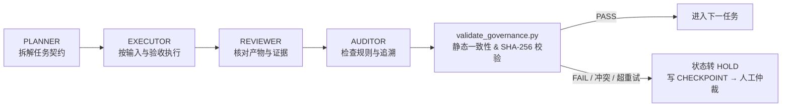
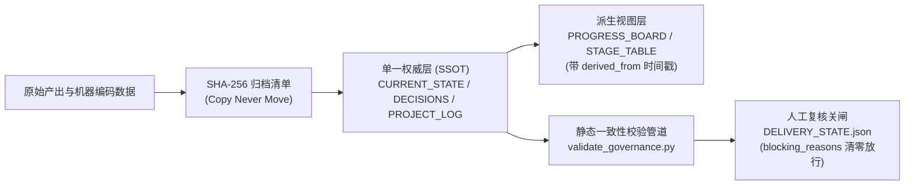

# 🔁 Agent Relay Governance (ARG V2)

**面向长周期多 Agent 项目的轻量级、文件驱动、模型无关串行接力治理协议。**

[](SKILL.md)
[](scripts/validate_governance.py)
[](assets/templates/)
[](#license)

[为什么需要 ARG](#为什么需要-arg) · [核心机制](#核心机制) · [治理文件分工](#治理文件分工) · [快速开始](#快速开始) · [可选接入 OpenViking](#可选接入-openviking) · [开源致谢](#开源致谢) · [English Overview](#english-overview)

---

## 为什么需要 ARG

在跨多天、跨会话、跨模型（如 Claude、Codex、OpenCode、GPT）协作的长周期项目中，AI Agent 往往不是死在单次能力不足，而是死在**交接失真**：
- 新会话把全部历史塞进上下文导致噪声爆炸，或者漏读关键前置决策；
- 不同文档互相矛盾时，模型靠“看起来更合理”静默覆盖事实；
- 上一个 Agent 没验证就宣称完成，下一个 Agent 在错误状态上继续推进。

**ARG 是协议，不是 Agent Runtime**：不依赖编排框架、不绑定特定模型、不做默认并行调度。它只用 Git 友好的普通文件 + 零外部依赖的 Python 静态校验器，让任意模型都能按顺序、有据可依地接过接力棒。

### 适用人群与使用场景

- **适合谁用**：使用 Claude Code、Codex、OpenCode、Cursor 等多种 AI Coding Agent 推进跨天/跨阶段项目的独立开发者、数据分析师与小型研发/科研团队。
- **适合用来做什么**：
  - 跨会话、跨模型接力开发长周期工程或数据处理项目，确保进度与决策不丢失；
  - 为大模型打分、自动标注等机器编码数据建立可审计的 SHA-256 归档与人工复核放行关闸。
- **不适合做什么**：几分钟就能写完的一次性脚本，或需要多 Agent 自动并发调度运行时的场景。

---

## 核心机制



### 设计不变量（Invariants）

- **串行接力（Serial Handoff）**：同一时刻只有一个执行者；新执行者只能在 `PAUSED / HOLD + CHECKPOINT` 或显式交接记录后接手。
- **角色与模型解耦（Model Agnostic）**：`PLANNER` / `EXECUTOR` / `REVIEWER` / `AUDITOR` 是逻辑角色，可由任意模型承担。
- **按需加载上下文**：每次接手只先读 `AGENTS.md` 和 `CURRENT_STATE.yaml`，再按 `context.required` 与 `context.conditional` 加载，禁止全量灌入日志。
- **先验证再 PASS（Verify before PASS）**：任务交接以结构化 Task Contract（输入、输出、验收条件、`max_attempts`）为单元，禁止跳过验证直接标记完成。
- **冲突仲裁优先级**：`可执行/文件/数据证据` > `DECISIONS.md 中的 ACTIVE/FROZEN 决策` > `转 HOLD 交人工仲裁`（禁止投票或静默覆盖）。

---

## 治理文件分工

每类事实只有**唯一权威所有者**，禁止在两个文件里复制同一份状态：

| 文件 | 角色定位 | 权威职责 |
| --- | --- | --- |
| `AGENTS.md` | 项目宪法 | 项目规则、角色边界与交接要求 |
| `CURRENT_STATE.yaml` | 工作状态（Working State） | 当前阶段、任务契约、阻塞项、下一步与按需加载规则 |
| `CHECKPOINT.md` | 恢复现场（Resume Memory） | 仅在 `PAUSED / HOLD` 或交接中断时写入的恢复包 |
| `PROJECT_LOG.md` | 事件历史（Episodic History） | 追加式执行、验证与纠错日志（只追加 `CORRECTION`，不篡改历史） |
| `DECISIONS.md` | 决策记忆（Decision Memory） | 关键决策理由与状态（`ACTIVE / FROZEN / SUPERSEDED`） |
| `LESSONS.md` | 经验记忆（Procedural Memory） | 项目级失败模式与可复用规避规则 |
| `PROGRESS_BOARD.md` / `STAGE_TABLE.md` | 派生视图 | 面向人的进度总览；冲突时以 `CURRENT_STATE.yaml` 为准 |
| `DELIVERY_STATE.json` | 交付关闸 | 机器编码数据的人工复核与放行状态 |

> 详细规则见 [SKILL.md](SKILL.md)，数据交付与归档规范见 [人工复核流程](references/human-review-workflow.md) 与 [归档规则](references/data-archiving.md)，V1 升级见 [V1 到 V2 迁移指南](references/migration-v1-to-v2.md)。

---

## 业务理解与治理数据管道

长周期多 Agent 项目在业务上很容易陷入“文档越多、真相越模糊”的陷阱——本质上是缺少**数据建模中的单一事实源（SSOT）与血缘控制**。ARG 把项目协作抽象为一条可校验的治理数据管道：



- **权威层与派生层分离**：`CURRENT_STATE.yaml` 等 5 类核心文件各司其职、绝不重复记账；面向人阅读的看板文件标注 `derived_from` 来源，冲突时无条件以权威层为准。
- **只追加审计日志（Append-Only）**：`PROJECT_LOG.md` 禁止事后篡改历史记录，纠偏必须通过新增 `CORRECTION` 条目留痕，确保过程可审计。
- **机器数据入库前的人工复核闸门**：针对 LLM 打分、自动分类等机器编码数据，先写 `DELIVERY_STATE.json` 记录 `blocking_reasons`，人工逐条核验并按 ID 回写原始表，待阻塞项清零后才允许放行进入下游分析。

---

## 快速开始

1. **安装或引用协议**：克隆仓库到 Agent 的 Skill 目录，或在项目 `AGENTS.md` 中指引接手者读取 [SKILL.md](SKILL.md)。
2. **初始化治理文件**：从 [assets/templates/](assets/templates/) 复制 `AGENTS.template.md` 与 `CURRENT_STATE.template.yaml` 到目标项目根目录（重命名为 `AGENTS.md` 与 `CURRENT_STATE.yaml`），按需初始化 `CHECKPOINT.md`、`PROJECT_LOG.md`、`DECISIONS.md` 等模板。
3. **运行原生静态校验器**（纯 Python 标准库，无需 `pip install`）：

```bash
git clone https://github.com/JKW-NB/agent-relay-governance.git
python path/to/agent-relay-governance/scripts/validate_governance.py \
  --project-root path/to/your-project \
  --check-hashes
```

校验器覆盖状态词表、字段完整性、依赖引用、验收记录与 SHA-256 清单等一致性检查，退出码 `0`（`GOVERNANCE_VALIDATION = PASS`）表示通过，`1`（`FAIL`）表示存在阻断项。

---

## 可选接入 OpenViking

### 为什么引入 OpenViking

ARG 默认通过 `AGENTS.md` + `CURRENT_STATE.yaml` 按需加载上下文，能够稳定控制单次交接的上下文体积。但在跨多周、多阶段的长周期项目中，历史决策理由、早期复核记录和散落的背景证据往往分布在多个目录与历史日志中：
- 如果全量塞入上下文，会迅速放大噪声并挤占窗口；
- 如果全靠人工或 Agent 逐个目录翻找，又容易遗漏关键前置依据。

[OpenViking](https://github.com/volcengine/OpenViking) 提供了面向 AI Agent 的类文件系统上下文组织与语义检索能力，恰好补齐了 ARG 在**“长历史、跨文件按需检索”**上的短板，且无需改造 ARG 原本的纯文件状态协议。

### 接入后的提升

- **按需召回历史证据**：在完成 ARG 必需的本地状态读取后，可围绕具体问题定向检索历史决策与复核依据，减少全量读日志带来的上下文膨胀；
- **语义检索 + 确定性溯源**：适配器会对检索命中的来源核对本地登记路径与 SHA-256 哈希，返回可回原文定位的摘录、文件路径与行号，避免“只给摘要、无法核验”；
- **不破坏协议权威与离线可用性**：OpenViking 严格限定为可选、只读的历史检索层；**ARG 本地治理文件始终保有状态与决策的最终权威**，服务不可达时自动降级回纯本地流程。

### 接入步骤

1. 启动本机 OpenViking 并导入允许检索的历史资料副本；
2. 复制 [integrations/openviking/config.example.json](integrations/openviking/config.example.json) 填写本机地址、检索范围、来源路径与 SHA-256 哈希并显式启用；
3. 在完成 ARG 必需本地读取后，按需执行带来源核验的检索：

```bash
python integrations/openviking/retrieve.py \
  --project-root path/to/your-project \
  --config path/to/openviking.json \
  "What evidence supported the previous decision?"
```

### 当前验证状态与边界

- **已验证能力**：本机已验证来源 SHA-256 核验、服务不可达时的本地降级，以及操作者审阅后调用 ARG 原生校验器（详见 [integrations/openviking/README.md](integrations/openviking/README.md)）。
- **试点观察**：在以本仓库真实工程记录开展的交接试点中，纯本地与 OpenViking 路径均定位到了目标证据，但模型在两条路径下都未正确提出下一步，最终由操作者核验原始报告并通过回归。这印证了 ARG 的核心判断：**检索不能替代状态权威与人工审阅**。
- **边界声明**：本仓库不提供自动多 Agent 调度运行时，也不自动判定业务验收是否通过。

---

## 开源致谢

### OpenViking

感谢 **OpenViking 的作者、维护者与开源社区贡献者**。其面向 AI Agent 的上下文组织与语义检索能力，使 ARG 在保持轻量纯文件协议的同时，能够按需扩展跨阶段历史证据检索能力。[上游项目](https://github.com/volcengine/OpenViking)

上下文存储、目录组织与语义检索能力归功于 OpenViking 上游项目；本仓库的工作集中在串行接力治理协议、五类权威记忆分工、原生静态校验器，以及面向本地哈希核验与失败降级的只读检索适配层。[集成说明](integrations/openviking/README.md)

---

## English Overview

**Agent Relay Governance (ARG V2)** is a lightweight, file-driven, model-agnostic governance protocol and Agent Skill for long-horizon sequential handoffs. It is a protocol, not an agent runtime: any model can pick up work reliably by reading `AGENTS.md` and `CURRENT_STATE.yaml`, loading scoped context on demand, and verifying state integrity with the stdlib-only validator (`scripts/validate_governance.py`).

Optional [OpenViking integration](integrations/openviking/README.md) provides read-only historical retrieval verified against registered local SHA-256 sources, while ARG files retain full authority over task state and frozen decisions.

---

## License

MIT
